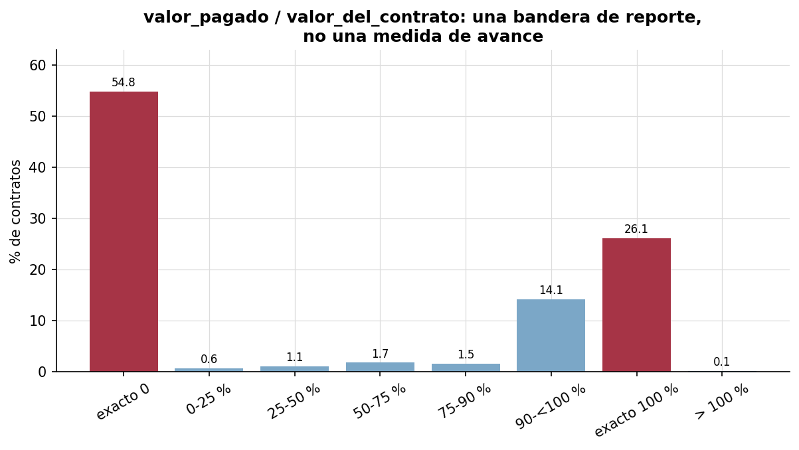
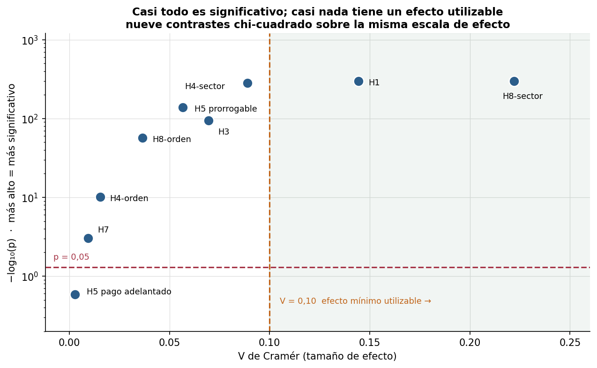
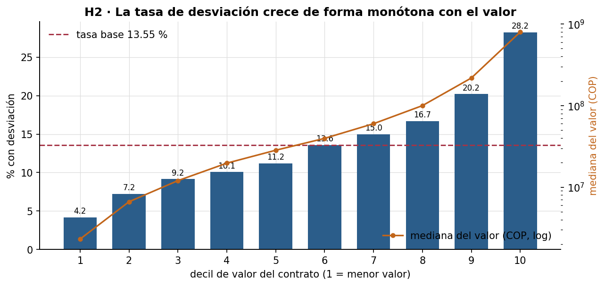
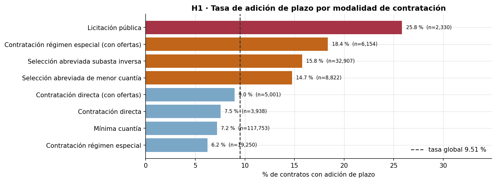
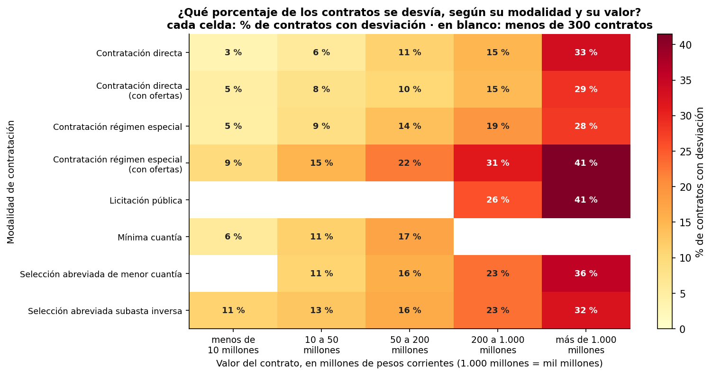
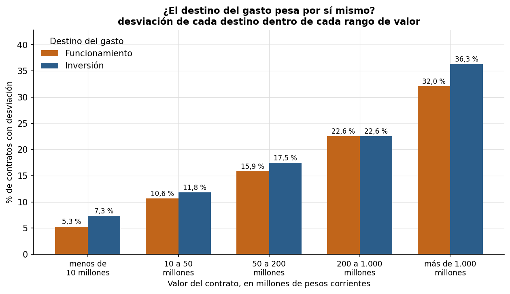
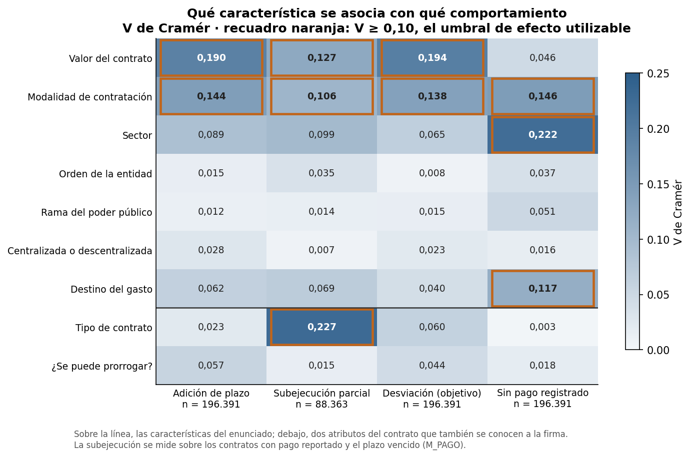
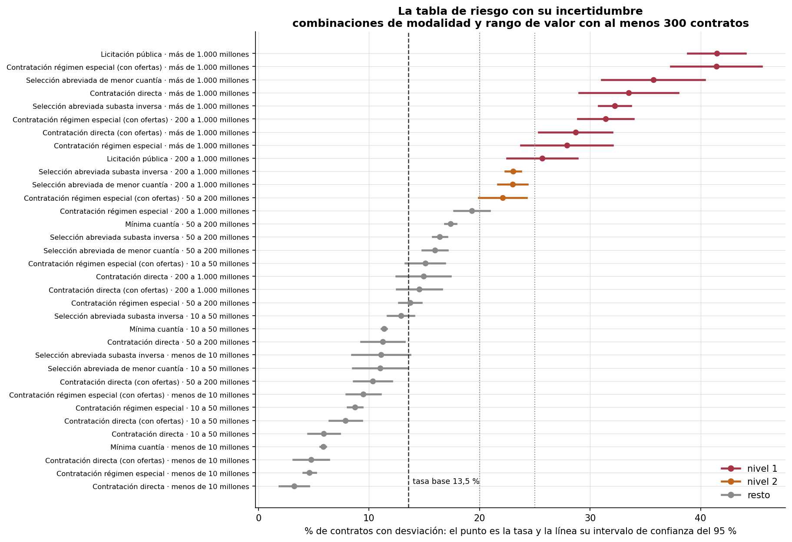
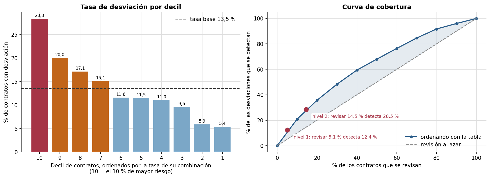
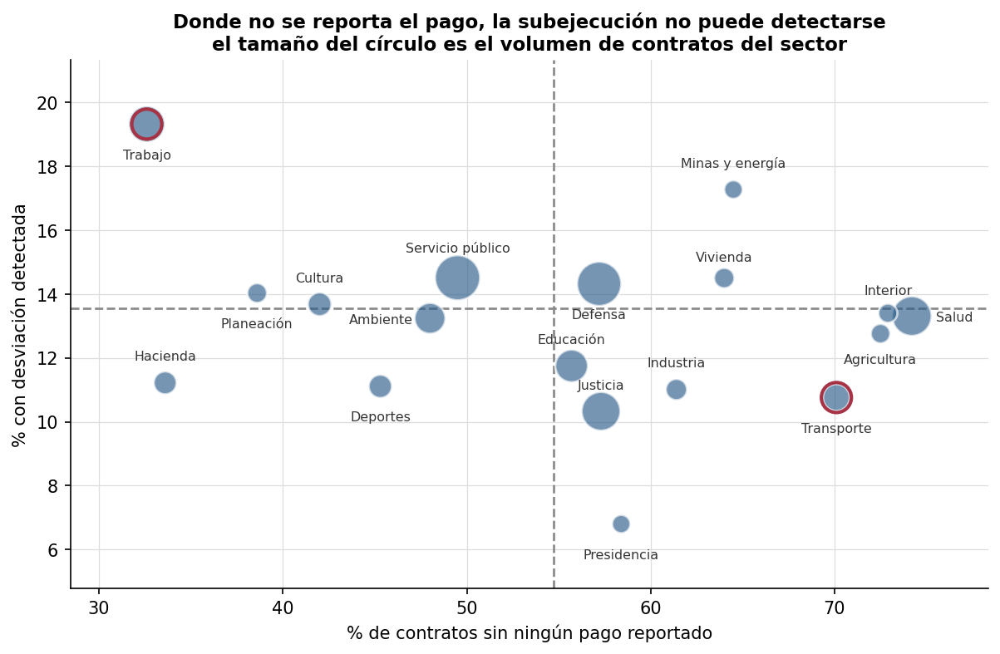

# Informe ejecutivo — Focalización de la supervisión de contratos de bienes

**Para:** Oficina de Control Interno
**Asunto:** Criterios basados en datos para priorizar el seguimiento de contratos de compraventa
y suministros
**Base de evidencia:** 196.391 contratos firmados por entidades públicas colombianas entre 2019
y 2025 (SECOP II)
**Reproducible en:** notebooks 01 a 04 de este repositorio

---

## 1. Resumen ejecutivo

El equipo de supervisión no puede seguir de cerca todos los contratos de bienes: solo en 2025 se
firmaron 40.113. Este análisis identifica **qué características, conocidas desde el momento de la firma,
se asocian con que un contrato se desvíe de su plan inicial**, y las convierte en un instrumento
de priorización.

**Tres conclusiones.**

1. **Solo dos atributos discriminan de verdad: el valor del contrato y la modalidad de
   contratación.** Se acumulan entre sí. Un contrato de licitación pública por encima de mil
   millones de pesos se desvía en el **41 %** de los casos; uno de contratación directa por
   debajo de diez millones, en el **3,2 %**. Un rango de **más de 12 veces**.

2. **La tabla de riesgo que se propone mejora de verdad a una revisión al azar, pero de forma
   moderada.** Revisando el **30 %** de los contratos de mayor riesgo se detecta el **48 %** de
   las desviaciones, 1,6 veces lo que daría el azar; en el nivel más estrecho, el 5 % de los
   contratos, la ganancia llega a 2,5 veces. Es una mejora real y medida, no un cambio de
   paradigma: más de la mitad de las desviaciones ocurre en contratos que la tabla no señala
   como prioritarios.

3. **El problema de mayor magnitud que encontramos no es de ejecución sino de registro.** El
   **54,7 %** de los contratos no tiene ningún pago reportado en la plataforma, y esa omisión se
   concentra fuertemente por sector. Requiere un frente de acción distinto y previo.

**Una advertencia que condiciona todo el informe.** Las tres definiciones de desviación que
plantea el encargo no son directamente medibles con estos datos; hubo que redefinir el objetivo
(§2). Y como el 54,7 % de los contratos es una zona ciega, **toda tasa de este informe es un
piso, no una estimación del incumplimiento real**.

---

## 2. Qué se pudo medir, y qué no

El encargo define la desviación de tres formas. Ninguna resultó utilizable tal cual:

| Definición original | Prevalencia | Veredicto |
|---|---|---|
| Adición de plazo | 9,5 % | **Utilizable** |
| Presupuesto comprometido no ejecutado | 59,6 % | **No utilizable** |
| Cierre sin liquidar | 60,3 % | **No utilizable como objetivo** |
| Las tres combinadas | **83,8 %** | **No utilizable** |

**Por qué fallan.** El campo de pagos es prácticamente **binario**: el 54,8 % de los contratos
marca exactamente cero, el 26,1 % exactamente el 100 % y otro 14,1 % queda entre el 90 % y el
100 %. Funciona como una bandera de reporte, no como una medida de avance; solo el 4,9 % muestra
ejecución parcial real. Contar el cero como
subejecución convertiría un fallo administrativo de registro en un hallazgo de supervisión. Y
`liquidación = No` se activa en 6 de cada 10 contratos: describe la norma administrativa, no una
anomalía; además, el campo ni siquiera mide si el contrato se liquidó (§3.6). Un indicador que
señala al 84 % del universo no focaliza nada.

**Definición adoptada:**

> **Desviación** = adición de plazo **o** subejecución parcial real: un pago mayor que cero pero
> inferior al 90 % del valor contratado, evaluado solo en contratos con el plazo ya vencido.

Prevalencia: **13,5 %** (26.603 contratos). Es una tasa que sí permite priorizar.

---

## 3. Qué se asocia con la desviación

El análisis se organizó en ocho preguntas. En palabras simples:

| # | La pregunta | Herramienta |
|---|---|---|
| H1 | ¿Alargar el plazo depende de cómo se contrató (licitación, mínima cuantía, directa…)? | Chi-cuadrado |
| H2 | Si se ordenan los contratos del más barato al más caro, ¿la desviación sube con el precio? | Correlación |
| H2b | ¿Los contratos que se desvían valen más que los que no? | Z test |
| H3 | ¿Pagar solo una parte pasa más en gasto de inversión o en gasto de funcionamiento? | Chi-cuadrado |
| H4 | ¿Alargar el plazo depende de si la entidad es nacional o territorial? ¿Y del sector? | Chi-cuadrado (dos veces) |
| H5 | ¿Se alargan más los contratos que dicen «prorrogable»? ¿Y los que permiten pago adelantado? | Chi-cuadrado (dos veces) |
| H6 | Entre los contratos que sí se alargaron, ¿el número de días añadidos cambia según el sector? | ANOVA |
| H7 | Control: ¿el género del representante legal tiene que ver con la desviación? | Chi-cuadrado |
| H8 | ¿Dejar de registrar pagos se concentra en ciertos tipos de entidad o sectores? | Chi-cuadrado (dos veces) |

Son ocho hipótesis pero doce pruebas, porque H4, H5 y H8 hacen dos preguntas cada una y H2
tiene dos versiones. Cada herramienta se eligió según el tipo de datos que cruza la pregunta y
todas verifican sus supuestos; el detalle técnico está en
[`02_correspondencia_estadistica.md`](02_correspondencia_estadistica.md).

Dos de las preguntas se hicieron esperando un «no»: H7 y la parte del pago adelantado de H5. Son
como el placebo de un experimento médico: si el género saliera importante, querría decir que el
método está detectando cosas que no existen. Además, el encargo pide reportar también lo que no
resultó.

**Qué quiere decir «significativo».** El valor p responde a esta pregunta: si en realidad no
hubiera ninguna relación, ¿qué tan raro sería ver, solo por casualidad, una diferencia como la
observada o mayor? Si es menor que 0,05 (menos de 1 en 20), el resultado es estadísticamente
significativo: es difícil explicarlo como casualidad.

**Significativo no quiere decir importante.** Con 196.000 contratos, **casi cualquier diferencia
deja de parecer casualidad**, incluso una de medio punto porcentual. Por eso el criterio de
decisión fue el **tamaño del efecto**, es decir, cuánto cambia de verdad la tasa de un grupo a
otro, contrastado contra umbrales fijados antes de ver los datos. En los cruces entre categorías
se mide con la V de Cramér, que va de 0 (ninguna relación) a 1 (relación total); por debajo de
0,10 el efecto se considera despreciable.

**Once de las doce pruebas son significativas y solo cinco superan su umbral de efecto.** De
esas cinco, una tiene un efecto propio pequeño una vez descontados el valor y la modalidad (el
destino del gasto, §3.4) y otra describe el registro y no la ejecución (§5). Quedan **dos
criterios de focalización: el valor del contrato y la modalidad**. La matriz de §3.6, que cruza
todas las características del encargo con todos los comportamientos, llega a lo mismo.

### 3.1 El valor del contrato — el criterio más potente

La tasa de desviación crece de forma **monótona sin excepción** a lo largo de los diez deciles de
valor: del **4,2 %** al **28,2 %**. La correlación entre nivel de valor y tasa de desviación es
r = 0,95 (IC 95 % [0,81; 0,99]).

Y los contratos que se desvían son **2,81 veces más caros** que los que no (IC 95 % [2,74; 2,88],
Z test sobre el logaritmo del valor, z = 84,0). En medianas: 71,1 millones frente a 30,0
millones.

### 3.2 La modalidad de contratación — el criterio más accionable

La licitación pública adiciona plazo en el **25,8 %** de los casos, frente al **6,2 %** del
régimen especial: un factor de 4,1. V de Cramér = 0,144, el mayor efecto entre las pruebas
primarias sobre la adición. Es un dato conocido a la firma y sin ambigüedad de clasificación.

### 3.3 Los dos efectos se acumulan

Dentro de cada modalidad la tasa crece con el valor, y dentro de cada banda de valor varía entre
modalidades. Esto es lo que hace viable un criterio combinado en vez de un umbral único.

### 3.4 Lo que el análisis descarta

Tres resultados negativos que conviene declarar explícitamente.

**El destino del gasto** (Funcionamiento / Inversión), que el encargo sugería como criterio
candidato. En bruto, la tasa de desviación difiere entre destinos (15,2 % en inversión frente a
12,4 % en funcionamiento), pero cerca de la mitad de esa diferencia es **composición**: la
inversión firma contratos más caros (el 18,8 % supera los 200 millones, frente al 14,1 % del
funcionamiento). Comparados dentro de cada rango de valor, los dos destinos quedan cerca: la
diferencia va de 0 a 4,3 puntos porcentuales y su V de Cramér no pasa de 0,045, lejos del umbral
de 0,10. No cambia a quién supervisar. La subejecución, vista por separado, sí es mayor en
funcionamiento (12,6 % frente a 8,3 %), pero es solo un componente del objetivo y va en sentido
contrario al total.

- **El orden de la entidad** (nacional, territorial o corporación autónoma). La diferencia no es
  casualidad (p = 6,7 × 10⁻¹¹), pero el efecto es despreciable (V = 0,015): la adición va del
  7,0 % en las corporaciones autónomas al 9,9 % en las entidades nacionales, y entre nacionales
  y territoriales la diferencia es de 0,7 puntos. No tiene capacidad práctica de discriminación.
- **El pago adelantado.** No significativo (p = 0,26): aun sin ninguna relación real, una
  diferencia así aparecería por casualidad una de cada cuatro veces. Pero es **por falta de
  datos, no por ausencia de efecto**: solo 335 contratos lo habilitan. La diferencia observada es
  de 2,0 puntos porcentuales, con un intervalo de confianza del 95 % que va de −1,5 a 5,5 puntos,
  así que los datos son compatibles tanto con ningún efecto como con uno considerable. La ausencia
  de evidencia no es evidencia de ausencia.

### 3.5 Un resultado que ilustra el riesgo de leer valores p

El **género del representante legal** resultó «significativo» (p = 0,0009): si el género no
tuviera nada que ver, una diferencia así aparecería por casualidad menos de una vez en mil.
Pero la diferencia real entre hombres y mujeres es de **0,43 puntos porcentuales** (13,84 %
frente a 13,41 %), con V de Cramér = 0,0094.

Si el criterio fuera el valor p, habría que concluir que el género predice la desviación
contractual y usarlo para focalizar. Sería un disparate estadístico, operativo y ético. **Esta
variable queda excluida de todo criterio.** Se incluyó deliberadamente en el análisis como control
para hacer visible el problema.

### 3.6 El mapa completo: cada característica frente a cada comportamiento

Las doce pruebas cubren solo algunos de los cruces que pide el encargo. Para no descartar
ninguno sin mirarlo, una matriz exploratoria cruza nueve características conocidas a la firma
con cuatro comportamientos y mide cada par con la V de Cramér. Es exploratoria: no reporta
valores p ni se suma a las pruebas primarias, que siguen siendo doce.

- **Confirma los dos criterios.** El valor y la modalidad son las únicas características que
  superan V = 0,10 a la vez en la adición de plazo, en la subejecución y en la desviación. En la
  adición pesa más el valor (0,190) que la modalidad (0,144).
- **La asociación más fuerte no estaba en el plan, y probablemente es estructural.** El tipo de
  contrato frente a la subejecución da V = 0,227: con pago registrado, los suministros quedan
  subejecutados en el 17,0 % de los casos y las compraventas en el 3,0 %, y los suministros suman
  el 87 % de las subejecuciones. Un suministro fija un tope que se consume según la demanda, así
  que pagar menos que el tope no es necesariamente una desviación. Además, los suministros no se
  alargan más que las compraventas (8,9 % frente a 10,3 %). Por eso el tipo de contrato no se usa
  como criterio de focalización: su asociación puede reflejar la forma del contrato y no el
  riesgo.
- **El tipo de entidad queda descartado en sus tres versiones.** El orden, la rama del poder
  público y la distinción entre entidades centralizadas y descentralizadas quedan por debajo de
  V = 0,06 frente a los cuatro comportamientos.
- **La falta de registro no es solo sectorial.** Además del sector (0,222), la modalidad (0,146)
  y el destino del gasto (0,117) se asocian con que el contrato no tenga ningún pago registrado.

La matriz no tiene columna para el cierre sin liquidar porque el campo **no mide la
liquidación**. De los 928 contratos cuyo plazo sigue vigente, 573 (61,7 %) figuran como
liquidados, y 565 de ellos siguen en ejecución o modificados. Entre los contratos ya vencidos,
la proporción de liquidados es menor (39,6 %).

**Robustez al periodo.** El registro de 2019 es distinto al de los demás años (el 60,2 % de sus
contratos empieza antes de la fecha de firma) y la adición registrada salta en 2025 (17,3 %,
frente al 9,3 % de 2024). Repetida sin 2019, la matriz no cambia: ningún par cruza el umbral de
0,10. Sin 2025, el valor y la modalidad pierden fuerza frente a la adición (de 0,190 a 0,156 y
de 0,144 a 0,126), pero siguen siendo las únicas características por encima del umbral en la
adición y en la desviación. El detalle está en el bloque E del notebook 01.

---

## 4. Criterios de focalización recomendados

### 4.1 La tabla de riesgo

Los dos criterios se aplican juntos, en una tabla: cada combinación de modalidad y rango de valor
tiene su tasa de desviación, la misma del mapa de calor de §3.3. Se consulta a mano con dos datos
que el contrato trae desde la firma. La figura muestra cada tasa con su intervalo de confianza del
95 %: las combinaciones de la cabeza quedan muy por encima de la tasa general, así que su riesgo
no es un accidente de la muestra.

Las cinco combinaciones de mayor riesgo:

| Combinación | Contratos | Se desvía | IC 95 % | Eficiencia |
|---|---|---|---|---|
| Licitación pública, más de 1.000 M | 1.358 | **41,5 %** | 38,8 % – 44,1 % | 3,06× |
| Régimen especial con ofertas, más de 1.000 M | 553 | **41,4 %** | 37,3 % – 45,5 % | 3,06× |
| Selección abreviada de menor cuantía, más de 1.000 M | 406 | 35,7 % | 31,1 % – 40,4 % | 2,64× |
| Contratación directa, más de 1.000 M | 427 | 33,5 % | 29,0 % – 38,0 % | 2,47× |
| Subasta inversa, más de 1.000 M | 3.945 | 32,2 % | 30,8 % – 33,7 % | 2,38× |

La **eficiencia** compara la tasa del grupo con la general (13,55 %): 3× quiere decir que se
encuentran tres veces más desviaciones que revisando al azar.

### 4.2 Cuánto supervisar: el costo y la cobertura

Si se ordenan los contratos por la tasa de su combinación, revisar el **30 %** de mayor riesgo
detecta el **48,3 %** de las desviaciones. Para operar se proponen dos niveles, que coinciden con
reglas fáciles de enunciar:

- **Nivel 1:** todo contrato de más de 1.000 millones, en cualquier modalidad, y los de 200 a
  1.000 millones adjudicados por licitación pública o por régimen especial con ofertas.
- **Nivel 2:** agrega los de 200 a 1.000 millones en toda modalidad salvo la contratación directa
  (con o sin ofertas) y el régimen especial sin ofertas, y los de régimen especial con ofertas de
  50 a 200 millones.

| Grupo | Contratos | % del universo | Se desvía | Desviaciones detectadas | Eficiencia |
|---|---|---|---|---|---|
| **Nivel 1** | **9.968** | **5,1 %** | **33,2 %** | **12,4 %** | **2,45×** |
| Nivel 2 | 28.493 | 14,5 % | 26,6 % | 28,5 % | 1,96× |
| Menos de 10 millones | 42.069 | 21,4 % | 5,8 % | 9,2 % | 0,43× |

**Recomendación:** empezar por el **nivel 1** (5 % del universo, donde uno de cada tres contratos
se desvía) y ampliar al nivel 2 según la capacidad del equipo: ese nivel detecta más de la cuarta
parte de las desviaciones revisando uno de cada siete contratos.

En el otro extremo, los **contratos de menos de 10 millones** son la quinta parte del universo y
concentran menos de la décima parte de las desviaciones: son candidatos a revisión por muestreo.
Liberar ese esfuerzo es lo que financia la supervisión estrecha de la cabeza.

### 4.3 Alerta específica

**13.726 contratos recibieron adición de plazo pese a estar marcados como no prorrogables.** O el
campo está mal capturado, o se adicionó plazo sin habilitación contractual. En ambos casos merece
revisión, y es un criterio independiente de la tabla de riesgo.

---

## 5. Segundo frente: calidad del registro

El hallazgo de mayor tamaño de efecto de las pruebas primarias (V = 0,222) no es sobre la
ejecución de los contratos sino sobre **su registro**. El 54,7 % de los contratos no tiene ningún
pago reportado, y la omisión se concentra por sector:

| Sector | Sin pago reportado |
|---|---|
| Salud y protección social | **74,2 %** |
| Interior | 72,9 % |
| Agricultura | 72,5 % |
| Transporte | 70,1 % |
| *(media del universo)* | *54,7 %* |

**Hay un sesgo de medición que puede invertir las prioridades.** Por construcción, la
subejecución exige que haya un pago registrado: en la zona ciega la señal no es baja, es
*estructuralmente indetectable*. Los extremos lo ilustran: Transporte no registra pago en el
70,1 % de sus contratos y se desvía menos de lo que anticipa su mezcla de valor y modalidad
(10,8 % frente a 14,3 %); Trabajo, el sector que mejor reporta (32,6 % sin pago), se desvía más
de lo esperado (19,3 % frente a 13,3 %).

**Alcance de esta afirmación.** La correlación a nivel de sector entre no-reporte y desviación
detectada es de ρ = −0,17 con **p = 0,50**: aun sin ninguna relación real, una correlación así
saldría por casualidad la mitad de las veces. Con 18 sectores no hay potencia para establecerla,
y **no la usamos como evidencia**. El argumento se sostiene en la construcción de la métrica, no en
esa correlación. Los sectores van en la dirección esperada, pero no todos: de los 11 que reportan
peor que la media, 8 se desvían menos de lo que anticipa su mezcla, frente a 2 de los 7 que
reportan mejor. Interior (72,9 % sin pago), Minas y energía (64,5 %) y Vivienda (64,0 %) reportan
mal y aun así se desvían más de lo esperado (13,4 % frente a 11,5 %; 17,3 % frente a 16,1 %;
14,5 % frente a 12,5 %).

**Recomendación.** Antes de desatender a un sector porque su tasa de desviación es baja, exigirle
el registro completo de pagos y recalcular. La ausencia de hallazgos en un sector que no reporta no es
evidencia de cumplimiento.

---

## 6. Limitaciones

1. **La zona ciega.** El 54,7 % de los contratos no registra pagos y los datos no permiten
   distinguir «no se ejecutó» de «no se reportó». Todas las tasas de este informe son un piso.
2. **Discriminación moderada.** Revisar el 30 % de los contratos de mayor riesgo detecta el 48 %
   de las desviaciones: más de la mitad ocurre en contratos que la tabla no señala como
   prioritarios. Ninguna otra característica de la matriz de §3.6 supera el umbral frente a la
   desviación. El año de firma y la duración declarada sí, pero no sirven como criterio: todo
   contrato nuevo tiene el mismo año, y la duración puede estar contaminada por la adición
   (limitación 7).
3. **Sesgo de medición por sector**, descrito en §5.
4. **Valores nominales sin deflactar.** Los rangos de valor están en pesos corrientes y el periodo
   cubre siete años con inflación acumulada considerable: **los cortes de la tabla de riesgo deben
   revisarse periódicamente**. No se incorporó una serie de IPC porque el repositorio no puede
   incluirla de forma verificable.
5. **Deriva temporal fuerte.** La tasa de desviación pasa del 8,0 % en 2019 al 21,7 % en 2025, y
   2025 se desvía un 54 % más de lo que anticipa su mezcla de valor y modalidad (21,7 % frente a
   14,1 %). El año se asocia con la desviación casi tanto como la modalidad (V = 0,128 frente a
   0,138). La adición registrada salta en 2025 en todas las
   modalidades y en los dos órdenes, sin concentrarse en pocas entidades. Puede ser un cambio en
   el registro de las modificaciones y no un empeoramiento real; los datos no permiten separarlos. Ese año amplifica el efecto del valor, aunque no lo
   crea: dentro de cada año la adición crece con el valor, y en 2025 va del 6,3 % en la banda
   más baja al 46,0 % en la más alta. El registro de 2019 también es distinto, pero quitarlo no
   cambia ninguna conclusión (§3.6). La tabla de riesgo no usa el año, pero sus tasas envejecen:
   **recalcularla al menos una vez al año**.
6. **Asociación, no causalidad.** El análisis no identifica el mecanismo por el que un contrato se
   desvía. Sirve para priorizar a quién mirar, no para atribuir responsabilidad.
7. **Un dato inutilizable.** La duración declarada del contrato tiene el gradiente más fuerte de
   todos (del 7,0 % de desviación en los contratos de hasta un mes al 49,8 % en los de más de un
   año), pero se excluyó: no está claro si el campo se actualiza tras una adición —el 15,6 % de
   los contratos con adición declara una duración menor que la adición recibida—, y contiene
   fechas escritas dentro (`30092025 Mes(es)` es el 30/09/2025, que leído como duración da 2,5
   millones de años).
8. **Cobertura parcial.** SECOP II no recoge toda la contratación pública del país, y el dataset
   está prefiltrado a bienes: las conclusiones no se extienden a servicios, obra ni consultoría.
9. **Desenlaces aún abiertos.** La subejecución solo se evalúa donde el plazo ya venció, porque
   un contrato en curso que lleva pagado el 40 % no está subejecutado: no ha terminado. Los 948
   contratos cuyo desenlace aún no es observable (0,48 % del universo: 928 con el plazo vigente y
   20 con la fecha de fin anulada por imposible) quedan con la señal financiera en «desconocida»
   y solo pueden clasificarse por adición de plazo: en ese margen, la prevalencia es un piso.

---

## 7. Reproducibilidad

Todas las cifras se generan ejecutando en orden los notebooks 01 a 04: el `sha256` de la entrada
queda en la salida del notebook 01, la fecha de observación está congelada en `src/config.py` y
todo muestreo usa una semilla fija; tablas en `reports/tablas/` y figuras en `reports/figures/`.
Todas las técnicas son las del curso (pruebas de hipótesis, intervalos de confianza y estadística
descriptiva, sin modelos predictivos); cada contraste, con sus umbrales fijados a priori y sus
supuestos, está en [`02_correspondencia_estadistica.md`](02_correspondencia_estadistica.md).
